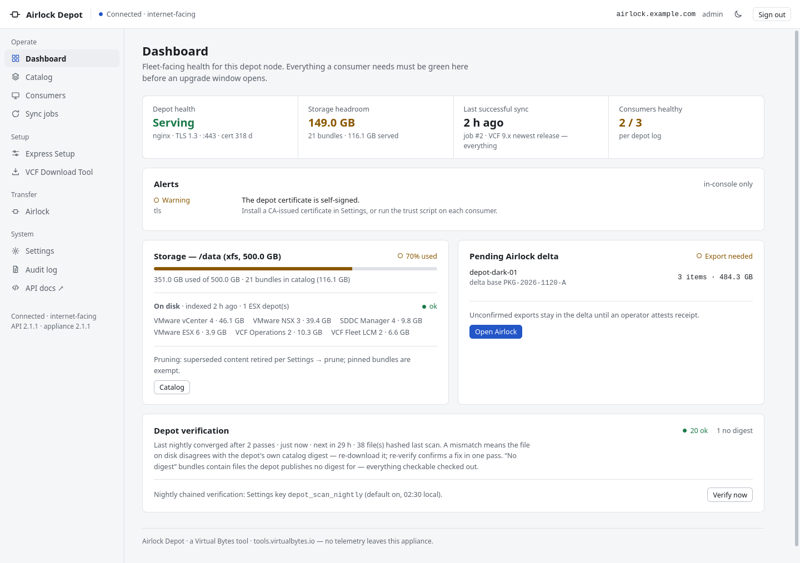

# Airlock Depot

A **Virtual Bytes** tool · https://virtualbytes.io · https://tools.virtualbytes.io

Airlock Depot is a virtual appliance (Photon OS 5) that productizes the
VMware Cloud Foundation 9.x **offline depot**: a connected appliance
downloads and packages depot content, signed transfer media crosses the
air gap, and a dark-site appliance verifies every chunk and serves VCF
consumers (SDDC Manager, VCF Installer) inside the gap.

## Downloads

Grab the OVAs from the **[Releases](../../releases)** page:

- `airlock-depot-<version>.ova` — dual-configuration OVA; pick
  **Connected** or **Disconnected (Dark Site)** in the vSphere deploy
  wizard.
- `airlock-depot-<version>-darksite.ova` — restricted single-configuration
  descriptor for separately delivered high-side media. Same disk bits;
  only the descriptor differs.

Only OVAs are distributed here. Signed service patches and OS update
bundles for appliances already deployed are delivered separately.

### Verify before deploying

Each OVA ships with `.sha256` and `.sha512` files and a detached GPG
signature (`.sig`) attached to the release. The release public key is in
[`signing/airlock-release-signing-6BBD491746B33CE0.asc`](signing/airlock-release-signing-6BBD491746B33CE0.asc);
its fingerprint is `18B3 C542 A907 10DD 9CFA 3880 6BBD 4917 46B3 3CE0`.

```
sha256sum -c airlock-depot-<version>.ova.sha256
gpg --import airlock-release-signing-6BBD491746B33CE0.asc
gpg --verify airlock-depot-<version>.ova.sig airlock-depot-<version>.ova
```

`gpg --verify` must report a good signature from *Airlock Depot Release
Signing (Virtual Bytes)* with the fingerprint above.

<picture>
  <source media="(prefers-color-scheme: dark)" srcset="docs/dashboard-dark.png">
  
</picture>

## What's new in 2.1.1 — security release

- **Security fixes.** A November 2026 review of the API, the root-side
  helpers and the GUI found three ways the API's service account could become
  root; all are fixed, along with the rest of the findings. Signed patches
  older than the running version are refused, the database password, TLS key
  and probe settings are readable only by the account that needs them, a
  stranger can no longer keep `admin` locked out with failed sign-ins, the
  API runs in a tighter systemd sandbox, and version details are hidden
  before sign-in. **Upgrade every deployed appliance.**
- **Follows new VCF releases on its own.** A sync release of `9` means the
  newest VCF 9 release: each run asks the depot which releases exist, so
  9.1.1, 9.2 and later arrive without an appliance update. `9.1` follows the
  newest 9.1.x (it stayed on 9.1.0 before), `9.1.1` is one release,
  `9.1.1.0200` one build. Every job log names the release it resolved to.
- **Scheduled syncs run.** Each automatic subscription runs once per window
  (Express Setup sets 01:00–05:00, appliance time), one job at a time.
- **Choose what to download.** *Run sync now* lists upgrade bundles, install
  binaries, the ESX patch store and workload artifacts in plain words, and
  can list individual binaries and workload artifacts (Supervisor, Kubernetes
  releases, VKS packages, every VCF service, VCF CLI, DSM) from the upstream
  depot to pick from.
- **VCF Download Tool updates from the depot.** Upgrade syncs download the
  tool itself; the tool page lists those copies and stages one in a click. It
  is accepted only if the product catalog's signature verifies with the
  active tool's VMware signing certificate and the archive matches the
  catalog's checksum.
- **Redesigned interface** with light and dark themes (follows the browser,
  switchable from the top bar), clearer status marks and a phone layout.
- **Platform refresh.** Photon OS 5 at the 23 November 2026 patch level:
  kernel 6.12.116, OpenSSL 3.5.9, OpenSSH 10.6p2, curl 8.23.0, nginx 1.30.6,
  PostgreSQL 16.16, ClamAV 1.4.7. The image's SBOM scans with **zero Critical
  and zero High findings**.

**Upgrading a deployed 2.0.x or 2.1.0 appliance to 2.1.1:** apply the 2.1.1
service patch (it runs a one-time hardening step), take a VM snapshot, apply
the 2.1.1 OS update bundle, reboot.

## What's new in 2.1.0 — platform refresh

- **Current Photon OS 5 patch level.** The image is built from the Photon 5
  update repository instead of the 5.0 GA ISO level: kernel 6.12, systemd
  257, GRUB 2.12, current OpenSSL, OpenSSH, curl and about 140 more
  packages. The build reboots into the new kernel before the appliance is
  assembled, so what ships is what was booted. The image's SBOM scans with
  **zero Critical and zero High findings** (2.0.x images carried the 2023
  Photon GA packages, documented in their release notes).
- **OS update bundle for deployed appliances.** Settings → Appliance updates
  gains an *Operating system* section. Upload a signed OS update bundle,
  verify, apply, reboot: the appliance installs only the packages it still
  needs, proves the new kernel is bootable, and after the reboot confirms it
  is running it. No redeploy, no re-download of the depot. There is no
  rollback for OS packages, so take a VM snapshot first; the appliance says
  so before applying.
- **Bootloader password.** The GRUB menu on the VM console is protected.
  A fresh appliance uses the **admin password chosen at deployment**; it can
  be changed later from Settings → Bootloader password, which is also where
  an appliance upgraded with the OS bundle gets one. Normal boots never ask.
- **Reproducible package set.** The build fails if the sealed package list
  differs from the committed lock, so a rebuilt image is the image that was
  scanned.
- The API documentation (`/api/v1/docs/`) now covers API tokens and bearer
  authentication, the catalog gap report, vCenter content-library access and
  the workload-artifact endpoints.

**Upgrading a deployed 2.0.x appliance to 2.1.0:** apply the 2.1.0 service
patch, take a VM snapshot, apply the 2.1.0 OS update bundle, reboot, then
set a bootloader password from Settings. Appliances that stay on 2.0.x keep
working.

## What's new in 2.0.7

- **First boot on VMware Workstation, Fusion and hand-built VMs.** Those
  platforms cannot deliver vApp properties, so earlier releases stopped at
  "FIRST BOOT FAILED" with the console account locked. The appliance now
  comes up reachable with a one-time console password and a first-boot
  wizard, or reads its settings from `guestinfo.airlock.*` lines in the
  `.vmx`. vSphere deployments are unchanged. See *Deploying* below.

## What's new in 2.0.6

- **Catalog versus disk.** The Catalog page shows *Advertised but not synced*:
  every version the depot's product catalog lists whose files are not on
  disk, with the missing file names. The Consumers page lists the paths each
  consumer asked for and did not get. Background: the catalog is refreshed by
  every sync and lists every Broadcom release, while the depot holds only
  what was synced; a consumer such as SDDC Manager trusts the catalog and
  reports download errors for releases the depot never had.
- **Publish only synced releases** (Settings → Depot catalog, administrators).
  When on, the depot serves a copy of the catalog trimmed to the versions
  whose files are all on disk, re-applied after every sync, so consumers only
  ever see what the depot can deliver. Turning it off restores the upstream
  catalog exactly.
- **Component-scoped sync jobs no longer fail on component names the tool
  cannot filter by.** The depot's catalog lists more component names than the
  VCF Download Tool accepts for `--component`. The appliance now reads the
  accepted list from the tool itself, skips the rest before running anything,
  reports what it skipped in the job log and result, and greys those
  components out in the Run sync dialog. A job with no component selection
  still downloads everything in scope.
- **SAMPLE** is a selectable classification level on every role; it renders as
  the grey placeholder band and can never pass for a marking.

## Also new since 2.0.0

The 2.1.1 OVA is current (2.0.4 is withdrawn). Since 2.0.0 the appliance
gained:

- **In-place service patching.** Settings → Appliance updates takes a signed
  service patch, verifies it against the key built into the appliance,
  snapshots what it replaces, installs atomically, restarts the API and
  health-checks it, rolling back on its own if the new version does not come
  up. Roll back is one button; every step is audited. The depot on `/data`,
  the database, configuration and TLS material are never touched. Photon OS
  packages arrive separately as an OS update bundle (2.1.0 and later).
- **GUI accounts.** Administrators add, remove and reset `admin` or
  `operator` accounts from Settings. Operators can do everything except
  account management, appliance updates and the classification banner, and
  they list and revoke only the API tokens they created.
- **Classification banner by role.** The marking band is set once by an
  administrator. A connected (Internet-facing) depot offers *SAMPLE*, *None*
  and *UNCLASSIFIED* only; the dark-site deployment offers the full marking
  table (SAMPLE, UNCLASSIFIED, SECRET, TOP SECRET, TOP SECRET//SAP). SAMPLE
  is the grey placeholder band every new appliance shows until the level is
  set; it is not a marking.
- **SSH maintenance window** opened from the GUI as an audited action and
  closed again on time; SSH stays key-only.
- **Resilience.** `/data` is mounted by UUID with `nofail`, so a detached or
  re-enumerated data disk no longer stops the next boot in emergency mode.
- **Exports** show the on-disk package directory, and the build result stays
  on screen after a build.
- **Build transparency.** The image build produces an SBOM of the sealed
  image (Photon packages plus the API's Go modules) and scans it; the API is
  built with a current Go toolchain.

Appliances deployed from an earlier OVA keep working; apply the service
patch and the OS bundle to reach 2.1.1 in place, or redeploy from the 2.1.1
OVA.

## Deploying

Deploy the OVA in vCenter, choose the deployment configuration (role), and
fill in the vApp properties (FQDN, IP/CIDR, gateway, DNS, NTP, admin
password). The role is fixed by the configuration you pick — first boot
stamps it, configures the network, generates keys and TLS, and (2.1.0 and
later) sets the admin password as the bootloader password. The appliance UI
walks you through the rest via Express Setup.

### VMware Workstation, Fusion, or a hand-built VM

vCenter and ESXi hand the appliance its settings through the OVF environment.
Workstation and Fusion do not, so an appliance deployed there (2.0.7 and
later) comes up **unconfigured but reachable**: it keeps a DHCP address, and
the console shows a one-time password for the `admin` account together with
two ways to finish:

1. **Console wizard.** Log in on the VM console as `admin` with the one-time
   password and run

   ```
   sudo /opt/airlock/firstboot/airlock-firstboot.sh --wizard
   ```

   It asks for the role (connected or dark site), FQDN, IP address with
   prefix, gateway, DNS, NTP, an optional proxy, and a new admin password,
   then completes first boot exactly as a vCenter deployment would.

2. **Settings in the `.vmx`.** Before the first power-on, add lines such as

   ```
   guestinfo.airlock.role = "connected"
   guestinfo.airlock.fqdn = "airlock.example.com"
   guestinfo.airlock.ip_cidr = "10.40.8.21/24"
   guestinfo.airlock.gateway = "10.40.8.1"
   guestinfo.airlock.dns = "10.40.8.53"
   guestinfo.airlock.ntp = "pool.ntp.org"
   guestinfo.airlock.admin_password = "<14+ characters>"
   ```

   (`guestinfo.airlock.proxy` is optional and connected-only.) First boot
   reads them the same way it reads vApp properties.

The role is fixed once set; changing it means redeploying. Deployments
before 2.0.7 stop at "FIRST BOOT FAILED: no OVF environment" on these
platforms and cannot be entered; redeploy from a current OVA.

## Questions and problems

Use [GitHub Issues](../../issues) on this repository; it is the only contact
channel for Airlock Depot. Include the appliance version (Settings → Appliance
updates) and, for a failed sync, the job log from Sync jobs. Never post
passwords, activation codes or depot credentials in an issue. Replies are
best effort (see the disclaimer below).

## Disclaimer

Airlock Depot is provided by Virtual Bytes **AS IS**, without warranty of
any kind, express or implied. **No support, maintenance, updates, or
service levels are offered or implied.** Use at your own risk. Virtual
Bytes accepts no liability for any damages arising from its use. This is
a community tool, not a Virtual Bytes product offering; see
[LICENSE](LICENSE) for the full terms.

## Licensing

[MIT License](LICENSE). The appliance bundles third-party components under
their own licenses, inventoried in
[THIRD-PARTY-LICENSES.md](THIRD-PARTY-LICENSES.md).
